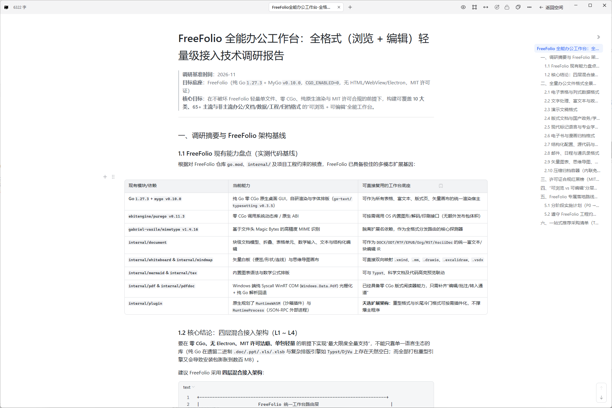

# FreeFolio

**A customized, local-first desktop multi-function workbench derived from ArcMD.**

[简体中文](README.md) · English

---

## Preview

  
  

[Workspace](assets/FreeFolio-home.png) · [File browsing](assets/FreeFolio-filemode.png) · [Settings](assets/FreeFolio-settings.png)

## About FreeFolio

FreeFolio is a local-first desktop multi-function workbench that combines note writing, multi-format document reading, whiteboards, and an AI assistant in one place.

Your notes, documents, and whiteboards live in local folders on your computer, so you can keep writing, reading, and organizing even without an internet connection.

## What you can do

- **Write and format notes.** Create class notes, project docs, or long-form drafts with note properties, images, tables, task lists, math formulas, and diagrams. Switch to full-width pages and export notes as PDF or HTML pages.
- **Read multiple formats and edit PDF pages.** Edit plain-text files directly, or open Word, Excel, PowerPoint, WPS, e-books, emails, mind maps, and archives in read-only view and click **Save as an Editable Markdown Copy** when you want to edit them. In PDFs, search inside the file, browse **Thumbnails and Contents**, or open **Edit PDF Pages** to rotate, delete, extract, split, merge, encrypt, and decrypt pages.
- **Organize spaces and jump straight to what you need.** Separate work and personal files into multiple spaces, or drag a folder from your file manager onto **+** to add a new space. Search across notes and PDFs, and use the **Outline** or document map to jump to any section in a long note.
- **Browse files anywhere.** Choose **Open File…** to open documents from any folder on your computer without adding that folder to a space. Opened files stay in separate tabs where you can save in place or use **Save as…**, without scanning the whole folder. Select **Return to workspace** to go back to your previous space.
- **Sketch on whiteboards.** Switch to **Whiteboard** from the home view or sidebar to jot ideas on sticky notes, connect plans with shapes and arrows, or view a whiteboard side by side with a note.

## Download and start

### Install FreeFolio

1. Open the [FreeFolio download page](https://github.com/OUBIGFA/FreeFolio/releases).
2. Download the installation file for your computer.
3. Open the downloaded file.
4. Follow the instructions on the screen to install FreeFolio.

### Get started

Open FreeFolio to view your workspace and sidebar:

1. **Create a note or space**: Select **+** above the document list for a new note, or select **+** in the space bar (or drag a folder onto **+**) to add a new space.
2. **Open an existing file**: In a space, select the folder icon below the file list and choose a **.md** note or another supported document. To open a file outside your spaces, select **Open File…** to enter file browsing mode, and choose **Return to workspace** or **Close Document** when you finish.
3. **Check the result**: Changes to your notes save automatically to your local folder, and you can select **Settings…** at the bottom to adjust language, fonts, or sidebar placement.

## Options

- **Ask OneBot for help.** Add your AI service or sign in with your ChatGPT account in **Settings → OneBot**. Ask questions across notes and PDFs in the current space with source citations, or drop files and images into the chat to ask OneBot for edits and review the suggested changes before applying them.
- **Keep notes in sync across computers.** Connect a supported cloud storage service in **Settings → Cloud Sync**, choose only the spaces you want to sync, and turn on content encryption if needed. Cloud sync is off by default.
- **Customize appearance and writing.** Adjust themes, fonts, line spacing, page width, sidebar placement, typewriter scrolling, and focus mode under **Settings → Appearance** and **Settings → Writing**.

## Notes

- **Offline use vs. online features**: Your notes and local documents stay on your computer so writing, reading, and whiteboards work offline. An internet connection is only needed for OneBot queries, cloud sync, and update checks.
- **Opt-in sync and read-only protection**: Cloud sync stays off until you turn it on for selected spaces. Read-only converted formats never modify the original file; save an editable copy if you need to make changes.
- **Updates and plugins**: On Windows, check and install updates in **Settings → Update** using **Check for Updates…**; other platforms link to the download page. The plugin marketplace is still in development (planned).

## Sources and license

FreeFolio uses ArcMD as its base and follows the MIT License.

[ArcMD](https://github.com/Ciao1019/ArcMD) · [MIT License](LICENSE) · [Third-party credits](third_party/README.md)
