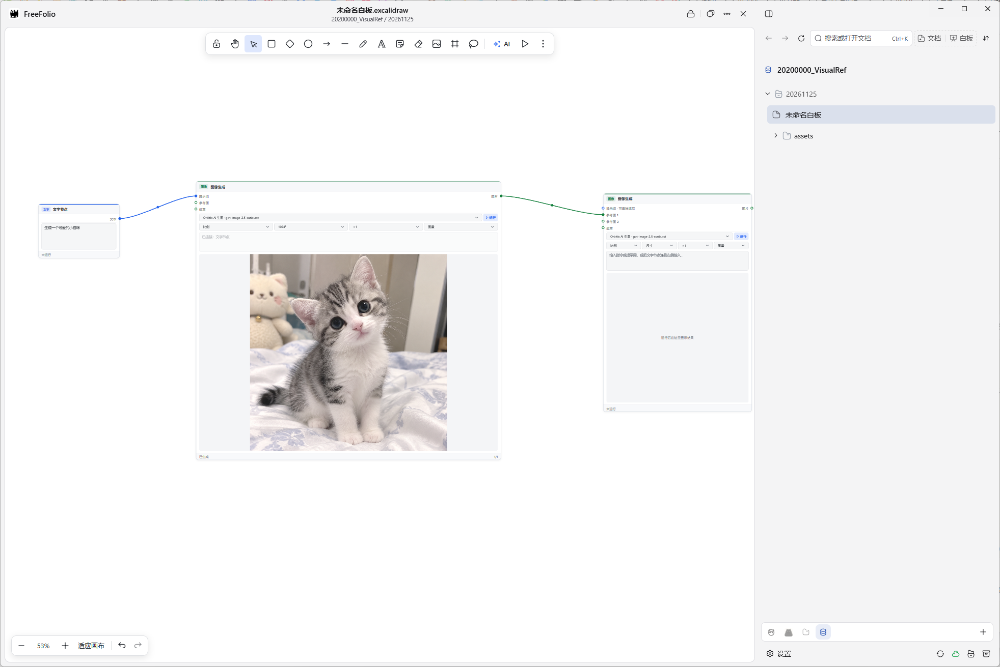

# FreeFolio

**A local-first desktop multi-function workbench.**

[简体中文](README.md) · English

---

## Preview

  
  

[Workspace](assets/FreeFolio-home.png) · [Whiteboard](assets/FreeFolio-whiteboard.png) · [File browsing](assets/FreeFolio-filemode.png) · [Settings](assets/FreeFolio-settings.png)

## About FreeFolio

FreeFolio is a local-first desktop multi-function workbench. It puts office file viewing, note writing, whiteboards, and an AI assistant in one window.

FreeFolio saves your notes, files, and whiteboards in folders on your computer. You can read, write, and draw without an internet connection.

## What you can do

### Office files and multiple formats

FreeFolio opens common office files and reference files in one window. You do not need to switch between many apps.

- **Open office files directly.** Open Word, Excel, PowerPoint, WPS, OpenDocument, RTF, and OFD files. FreeFolio opens these files in read-only mode and does not change the original file. Select **Save as an Editable Markdown Copy** to create an editable note.
- **Read and edit PDF pages.** Search text in a PDF, view **Thumbnails and Contents**, and switch between single-page and two-page views. Select **Edit PDF Pages** to rotate, delete, extract, split, merge, encrypt, or decrypt pages.
- **Open more file types.** Open e-books, emails, mind maps, diagrams, and archives in read-only mode. You can also edit plain-text files directly.

### Key features

- **Whiteboard AI image generation and creation.** Select **AI** on the **Whiteboard** toolbar to add text, image, and video nodes. Enter a prompt to generate images, or connect sticky notes, images, or frames to edit images and create videos. Browse past results and select **Place on Whiteboard** to add them to your board.
- **Write and format notes.** Add note properties, images, tables, task lists, math formulas, and diagrams to your notes. Use full-width pages or focus mode, and export notes as PDF or HTML pages.
- **Browse files anywhere.** Select **Open File…** to open a file from any folder on your computer. FreeFolio shows each file in a separate tab and does not scan the whole folder. Save changes to the original file or select **Save as…**, then select **Return to workspace**.
- **Organize spaces and find content fast.** Use separate spaces for work and personal files, or drag a folder onto **+** to add a space. Search across notes and PDFs, and use favorites, pins, bookmarks, **Outline**, and the document map to move quickly.
- **Draw on whiteboards in split view.** Select **Whiteboard** to add sticky notes, shapes, and arrows. You can view a whiteboard and a note side by side.

## Download and start

### Install FreeFolio

1. Open the [FreeFolio download page](https://github.com/OUBIGFA/FreeFolio/releases).
2. Download the installation file for your computer.
3. Open the downloaded file.
4. Follow the instructions on the screen to install FreeFolio.

### Get started

Open FreeFolio.

1. To create a note, select **+** above the file list.
2. To create a space, select **+** in the space bar, or drag a folder onto **+**.
3. To open a file in a space, select the folder icon below the file list.
4. Select a **.md** note, an office file, or a PDF.
5. To open a file outside a space, select **Open File…**.
6. Select **Return to workspace** or **Close Document** when you finish.
7. FreeFolio saves your note changes to your local folder. Select **Settings…** to change the language, font, or sidebar position.

## Options

- **Use OneBot and AI image generation.** Add your AI service (including image or video services) or sign in with your ChatGPT account in **Settings → OneBot**. Ask OneBot questions about notes and PDFs in the current space with cited sources, or generate and edit images and videos directly on the whiteboard.
- **Sync notes across computers.** Connect a supported cloud storage service in **Settings → Cloud Sync**. Select only the spaces you want to sync, and turn on content encryption if needed. Cloud sync stays off by default.
- **Customize appearance and writing.** Change the theme, font, line spacing, page width, sidebar position, typewriter scrolling, and focus mode in **Settings → Appearance** and **Settings → Writing**.

### Quick tips

- **Drag a folder to create a space.** Drag any folder from your computer directly onto **+** in the bottom space bar to create a new space right away.
- **Select whiteboard items to generate images.** Select sticky notes, images, or frames on the **Whiteboard**, then click **AI Image**, **AI Text**, or **AI Video** above the selection to create and connect a node automatically.
- **Turn read-only office files into notes.** While viewing a Word, Excel, or PowerPoint file, select **Save as an Editable Markdown Copy** to annotate and edit without changing the original file.
- **Open a file without adding a space.** Select **Open File…** to view or edit any file in a separate tab, then select **Return to workspace** when you are done.
- **Drop files into OneBot for edits.** Drag a file or image into OneBot to request text edits, and preview the changes before applying them.

## Notes

- **Offline and online use.** FreeFolio stores your notes and files on your computer, so reading, writing, and whiteboards work offline. You need an internet connection only for OneBot, cloud sync, and update checks.
- **Opt-in sync and read-only files.** Cloud sync stays off until you turn it on for selected spaces. FreeFolio opens office files, e-books, and archives in read-only mode and does not modify the original file.
- **Updates and plugins.** On Windows, select **Check for Updates…** in **Settings → Update** to download and install updates. Other platforms open the download page. The plugin marketplace is in development (planned).

## Sources and license

FreeFolio uses ArcMD as its base and follows the MIT License.

[ArcMD](https://github.com/Ciao1019/ArcMD) · [MIT License](LICENSE) · [Third-party credits](third_party/README.md)
