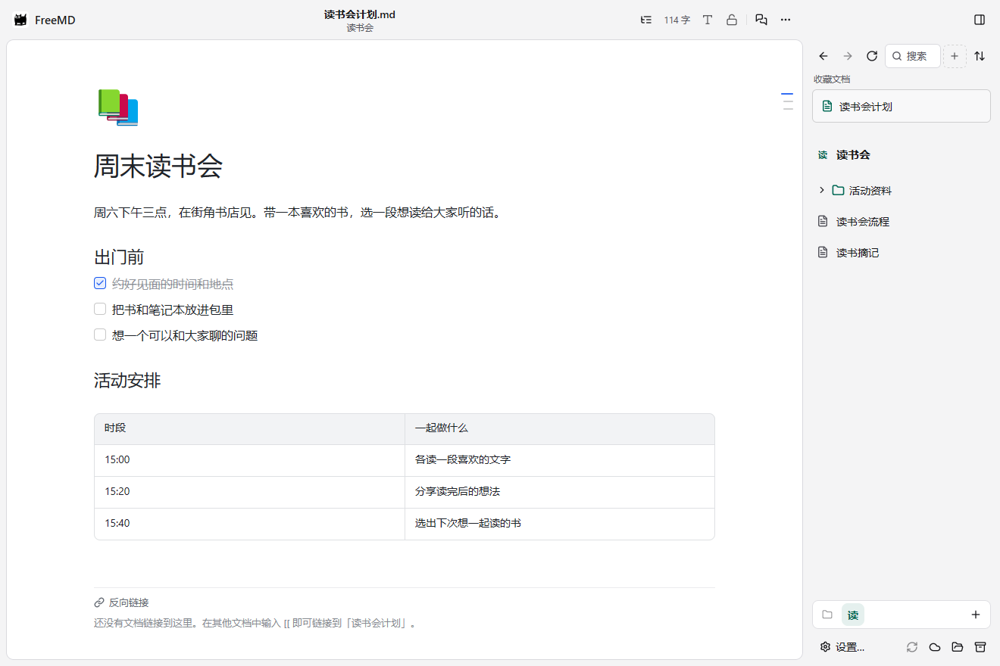
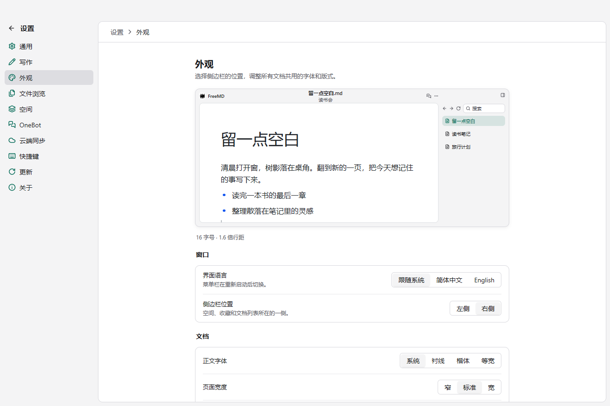

# FreeMD

**A customized, local-first native Markdown editor built in Go + MyGo, derived from ArcMD.**

[简体中文](README.md) · English

---

## Preview

  
  

[Home](assets/FreeMD-home.png) · [Settings](assets/FreeMD-settings.png) · [Whiteboard](assets/FreeMD-whiteboard.png)

## About FreeMD

FreeMD is an app for notes and drawings. It saves your notes in folders on your
computer. You can write notes without an internet connection.

## What you can do

- **Write notes.** Add pictures, tables, and lists of tasks to your class notes
  or meeting notes.
- **Browse files.** Open a note from any folder on your computer. You do not
  need to add the folder first. FreeMD shows selected files in separate tabs.
  Save changes to the original file. Use **Save As** to save a copy. FreeMD
  opens only the files you select. It does not scan the whole folder. Close
  file browsing to return to the space you used before.
- **Find notes.** Use different folders for work notes and personal notes.
  Enter words from a note in the search box.
- **Find a section in a long note.** Use a diagram to see the headings and
  lists in a note. Select an item in the diagram to go to that part of the note.
- **Make drawings on a whiteboard.** Write ideas on sticky notes. Use shapes
  and arrows to show the steps in a plan.
- **Share notes.** Save a note as a PDF. You can send or print this file.

## Download and start

### Install FreeMD

1. Open the [FreeMD download page](https://github.com/OUBIGFA/FreeMD/releases).
2. Download the installation file for your computer.
3. Open the downloaded file.
4. Follow the instructions on the screen to install FreeMD.

### Create or open a note

Open FreeMD.

- For a new note, select **+** above the list of files.
- To open a note in a space, select the folder icon below the list of files.
  Select a file with a name that ends in **.md**.
- To open a note outside a space, select **Open File…**. FreeMD opens file
  browsing. The file stays in its original folder.
- Close file browsing to return to the space you used before.

## Options

- **Use OneBot for help with your notes.** Add your AI service in **Settings**.
  You can ask OneBot questions about your notes. You can also ask OneBot to
  change text. You can see the changes before you accept them.
- **Use the same notes on more than one computer.** Connect to an online
  storage service that FreeMD supports. Select the folders to use on each
  computer. This option is off when you first use FreeMD.

## Sources and license

FreeMD uses ArcMD as its base. FreeMD uses the MIT License.

[ArcMD](https://github.com/Ciao1019/ArcMD) · [MIT License](LICENSE) · [Third-party credits](third_party/README.md)
