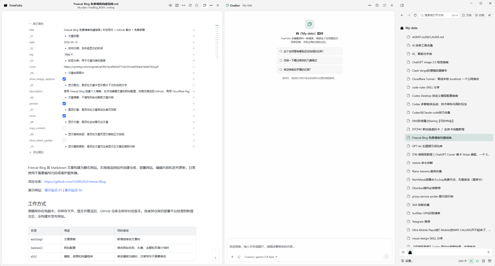
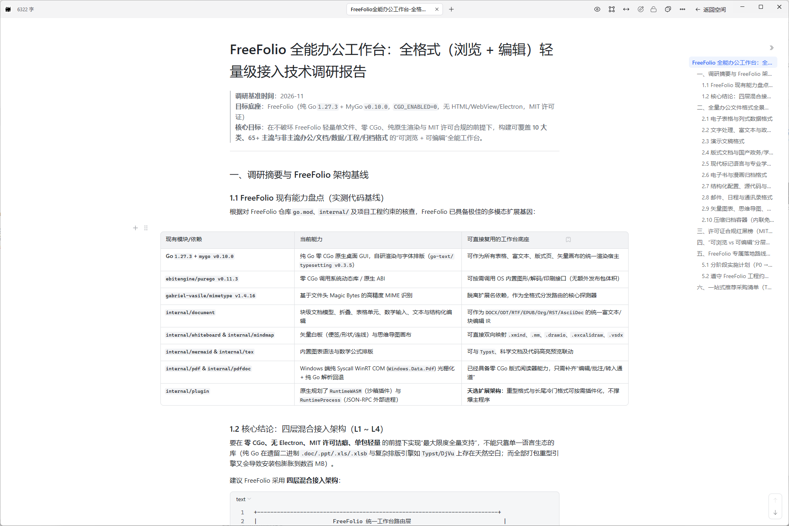
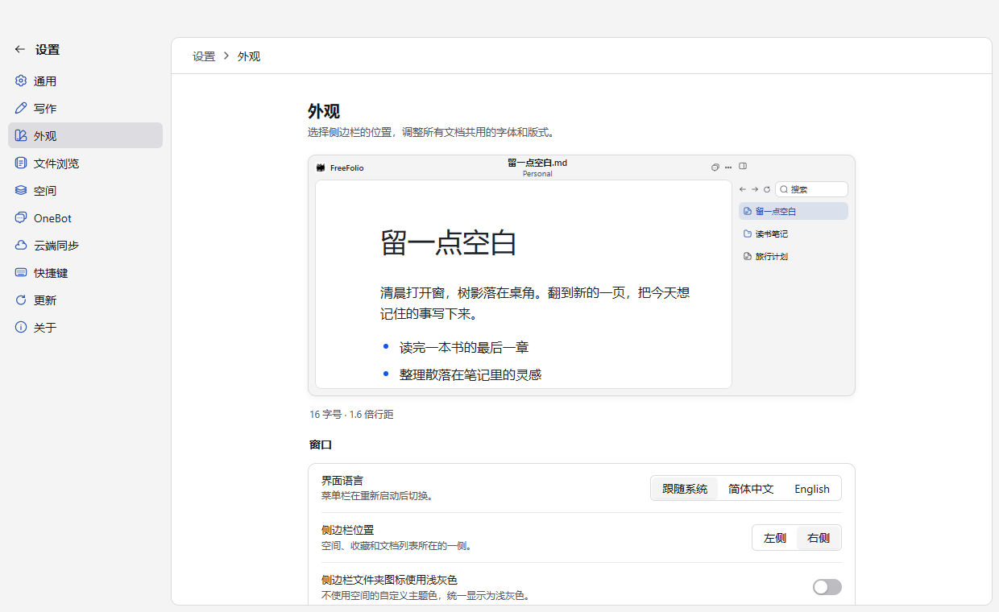

# FreeFolio

**基于 ArcMD 深度定制与优化的本地优先桌面多功能工作台**

简体中文 · [English](README.en.md)

---

## 界面预览

  
  

[主工作区原图](assets/FreeFolio-home.png) · [文件浏览原图](assets/FreeFolio-filemode.png) · [设置页原图](assets/FreeFolio-settings.png)

## 项目说明

FreeFolio 是一款本地优先的桌面多功能工作台，集笔记写作、多格式文档阅读、白板构思与 AI 助手于一体。

你的笔记、文档与白板都保存在电脑本地文件夹中。即使没有网络，也可以随时写作、查阅资料和整理想法。

## 可以用来做什么

- **写作与笔记排版。** 记录课堂笔记、项目资料或长文，支持笔记属性、图片、表格、待办清单、数学公式和流程图；可切换全宽页面，并导出为 PDF 或 HTML 网页。
- **多格式文档阅读与 PDF 页面编辑。** 直接编辑常见纯文本文件，或只读浏览 Word、Excel、PowerPoint、WPS、电子书、邮件、思维导图与压缩包，需要改写时可一键**存为可编辑的 Markdown 副本**；打开 PDF 后可在文件内查找、查看缩略图与目录，并通过**编辑 PDF 页面**对页面进行旋转、删除、提取、拆分、合并与加解密。
- **多空间整理与快速定位。** 用不同空间分开存放工作与生活资料，支持将文件夹直接拖到 **+** 新建空间；输入关键词即可同时检索笔记与 PDF 内容，借助**目录**或结构图快速跳到长文档的指定位置。
- **文件浏览模式。** 通过 **打开文件…** 直接打开电脑上任意位置的文档，不必先把文件夹加入空间。打开的文件显示在独立标签页中，支持原地保存或 **另存为…**，不会扫描整个文件夹；点击 **返回空间** 即可回到原来的工作区。
- **白板构思与分屏对照。** 在首页或侧边栏切换到 **白板**，用便签记下灵感，用形状和箭头梳理流程，也能与笔记分屏并排查看。

## 下载与上手

### 安装 FreeFolio

1. 打开 [FreeFolio 下载页](https://github.com/OUBIGFA/FreeFolio/releases)。
2. 下载适合你的电脑的安装文件。
3. 打开下载的文件。
4. 按屏幕上的提示安装 FreeFolio。

### 开始使用

打开 FreeFolio 后，屏幕上会显示侧边栏与工作区：

1. **新建笔记或空间**：点击文件列表上方的 **+** 新建笔记；或点击底部空间栏的 **+**（也可直接将电脑里的文件夹拖到 **+** 上）新建一个空间。
2. **打开已有文档**：在空间中点击文件列表下方的文件夹图标，选择 **.md** 笔记或其他支持的文档；打开空间外的文件时，使用 **打开文件…** 进入文件浏览模式，点 **返回空间** 或 **关闭文档** 即可退出当前文档或返回工作区。
3. **验证成果**：编辑笔记后内容会自动保存在本地文件夹中；你也可以在底部点击 **设置…** 调整界面语言、字体或侧边栏位置。

## 按需使用

- **请 OneBot 帮忙。** 在 **设置 → OneBot** 中添加你的 AI 服务，或登录 ChatGPT 账号。你可以结合当前空间里的笔记和 PDF 向 OneBot 提问并查看引用出处，也可以拖入文件或图片请它润色或修改文字，先预览修改效果再决定是否应用。
- **多台电脑同步笔记。** 在 **设置 → 云端同步** 中连接支持的云存储服务，只勾选需要同步的空间即可，并可按需开启内容加密。此功能默认关闭。
- **调整外观与写作习惯。** 在 **设置 → 外观** 与 **设置 → 写作** 中自定义主题、字体、行距、页面宽度、侧边栏位置、打字机滚动与专注模式。

## 注意

- **离线与联网范围**：所有笔记和本地文档均存储在你的电脑上，日常写作、阅读与白板均可离线使用；仅使用 OneBot 问答、云端同步或检查更新时需要联网。
- **默认关闭与只读保护**：云端同步默认关闭，不会自动上传未勾选的空间；Word、Excel、电子书等只读格式不会改写原文件，需要编辑时请另存为可编辑副本。
- **版本更新与扩展插件**：Windows 版本可在 **设置 → 更新** 中点击 **检查更新…** 完成下载与安装，其他平台会引导前往下载页获取新版本；扩展插件市场尚在开发中（计划中）。

## 来源与许可

FreeFolio 基于 ArcMD 开发，沿用 MIT 许可证。

[ArcMD](https://github.com/Ciao1019/ArcMD) · [MIT 许可证](LICENSE) · [第三方鸣谢](third_party/README.md)
